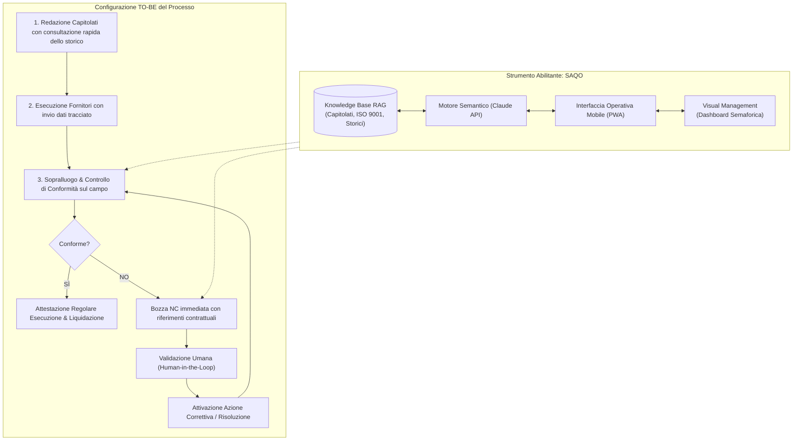

# BPR e Ottimizzazione del Processo di Gestione della Qualità — Fondazione UniSA

> **Progetto di Business Process Reengineering (BPR) e Miglioramento Continuo del Processo di Supervisione e Controllo dei Servizi Esternalizzati (Norma ISO 9001) mediante Metodologia Lean ed Integrazione dell'Intelligenza Artificiale Operativa (Sistema SAQO).**

---

## 📌 Indice dei Contenuti
- [Inquadramento del Progetto](#-inquadramento-del-progetto)
- [1. Analisi del Contesto, Stakeholder e VOC](#1-analisi-del-contesto-stakeholder-e-voc)
- [2. Mappatura del Processo Attuale (AS-IS)](#2-mappatura-del-processo-attuale-as-is)
- [3. Definizione degli Obiettivi S.M.A.R.T. e KPI](#3-definizione-degli-obiettivi-smart-e-kpi)
- [4. Analisi delle Cause Radice: Ishikawa e 5 Why](#4-analisi-delle-cause-radice-ishikawa-e-5-why)
- [5. Matrice Decisionale e Piano di Azione](#5-matrice-decisionale-e-piano-di-azione)
- [6. Il Processo Riprogettato (TO-BE) e il Supporto Operativo SAQO](#6-il-processo-riprogettato-to-be-e-il-supporto-operativo-saqo)
- [7. Valutazione dei Risultati (AS-IS vs TO-BE) e Piano Kaizen](#7-valutazione-dei-risultati-as-is-vs-to-be-e-piano-kaizen)
- [Struttura del Repository](#-struttura-del-repository)
- [Crediti Accademici](#-crediti-accademici)

---

## 📖 Inquadramento del Progetto

Il progetto analizza e reingegnerizza il processo di gestione della qualità e controllo di conformità presidiato dalla **Fondazione UniSA** (struttura operativa dell'Università degli Studi di Salerno) per i servizi esternalizzati di pulizia, cura del verde e ristorazione, operanti sotto lo standard di certificazione **ISO 9001**.

L'intervento adotta un approccio rigoroso di **Quality Management e Lean Thinking**: partendo dall'evidenziazione degli sprechi (*Muda*) e dei colli di bottiglia operativi, risale alle cause strutturali tramite strumenti diagnostici di qualità, definisce il nuovo flusso **TO-BE** e individua nella digitalizzazione con AI documentale (**SAQO**) la contromisura abilitante, secondo il paradigma **Human-in-the-Loop**.

---

## 1. Analisi del Contesto, Stakeholder e VOC

### 1.1 Stakeholder Analysis (Matrice Potere / Interesse)
La governance delle relazioni con gli attori del sistema qualità è stata mappata in 4 quadranti strategici:
* **Gestisci Attivamente (Alto Potere / Alto Interesse):** Università degli Studi di Salerno, Presidenza, Consiglio di Amministrazione (CdA), Responsabile Qualità.
* **Tienimi Soddisfatto (Alto Potere / Basso Interesse):** Ente Certificatore (ISO 9001), Commissione di Gara.
* **Tienimi Informato (Basso Potere / Alto Interesse):** Utenti finali (studenti, docenti, personale), Fornitori (Operatori Economici), funzioni operative interne.
* **Monitora (Basso Potere / Basso Interesse):** Comunità territoriale e istituzioni locali.

### 1.2 Voice of the Customer (VOC) e Identificazione dei Muda
Dall'ascolto dei requisiti espliciti e impliciti dei fruitori e della committenza sono emersi i principali sprechi di processo:
* **Muda di Attesa e Movimentazione:** La Funzione Qualità doveva recarsi fisicamente presso le strutture per raccogliere i registri cartacei (es. fogli firma nei locali), con elevato dispendio di tempo.
* **Muda di Sovra-processamento e Difetti:** Gestione documentale non standardizzata che generava frequenti rilavorazioni delle schede di contestazione per vizi di forma.
* **Aspettativa chiave:** Passare da un modello ispettivo **reattivo e discontinuo** a un modello **proattivo e tracciabile**, capace di intercettare il disservizio prima dell'utenza finale.

---

## 2. Mappatura del Processo Attuale (AS-IS)

L'analisi dell'**AS-IS** è stata condotta mediante diagramma di flusso strutturato su **Swimlane gerarchiche**:

```text
[UniSA / CdA / Presidenza]         --> Obiettivi strategici, firma contratti, riesame audit
[Commissione Esterna]              --> Valutazione indipendente offerte tecniche
[Responsabile Qualità]             --> Verifiche sul campo, gestione NC, emissione Regolare Esecuzione
[Uffici Interni (Amministrazione)] --> Gestione penali/decurtazioni, liquidazione fatture
[Operatore Economico / Fornitore]  --> Erogazione del servizio, registrazione su supporti cartacei
[Utenza Finale]                    --> Fruizione dei servizi, compilazione questionari di gradimento
```

### Le 5 Fasi Operative e i Gateway Decisionali:
1. **Pianificazione e Progettazione:** Raccolta requisiti e stesura del capitolato svolte manualmente a partire da zero, senza template strutturati; aggiudicazione della gara.
2. **Esecuzione Operativa:** Il fornitore esegue il servizio registrando le attività esclusivamente su modulistica cartacea dispersa nei vari plessi.
3. **Monitoraggio e Controllo (*Problema del Prelievo*):** Il Responsabile Qualità deve recarsi personalmente in loco per "prelevare" l'informazione.
   * *Gateway Decisionale:* **Conforme?** Se Sì, prosegue verso la liquidazione; se No, si attiva la procedura formale di Non Conformità (NC).
4. **Gestione Anomalie (Loop NC):**
   * *Gateway Decisionale:* **Anomalia Grave?** Se grave, inoltro all'amministrazione per applicazione penali; se lieve, richiesta di rimedio immediato con obbligo di riesame e riverifica.
5. **Chiusura e Valutazione:** Emissione dell'Attestazione di Regolare Esecuzione, pagamento fatture, audit periodici e riesame di direzione.

> **Criticità strutturale AS-IS:** Il Responsabile Qualità rappresentava l'unico depositario informativo e il collo di bottiglia operativo dell'intero processo.

---

## 3. Definizione degli Obiettivi S.M.A.R.T. e KPI

Per indirizzare la reingegnerizzazione sono stati fissati due macro-KPI di processo, declinati secondo la metodologia **S.M.A.R.T.**:

* **KPI 1 - Modalità di recupero informazioni:** Passaggio dal prelievo manuale a un flusso informativo condiviso (Target: **100% tempestività e accessibilità immediata**).
* **KPI 2 - Tempo dedicato a compiti a basso valore:** Riduzione delle ore settimanali impiegate in solleciti telefonici/email e ricerca fisica di documenti (Target: **-40% di tempo sprecato**).

| Criterio S.M.A.R.T. | Applicazione al Processo di Qualità Fondazione UniSA |
| :--- | :--- |
| **Specific (Specifico)** | Standardizzare il protocollo informativo, convertendo la logica da "prelievo manuale disperso" a flusso informativo strutturato. |
| **Measurable (Misurabile)** | Azzeramento totale (100%) del recupero fisico di fogli firma cartacei e taglio del 40% del tempo speso in solleciti documentali. |
| **Achievable (Raggiungibile)** | Colmare il divario di competenze procedurali e digitali del personale definendo ruoli chiari di *Process Owner*. |
| **Relevant (Rilevante)** | Assicurare la conformità ai contratti e ai requisiti ISO 9001, minimizzando contenziosi con i fornitori e reclami degli utenti. |
| **Time-Bound (Temporizzato)** | Protocolli definiti entro 1 mese; addestramento del personale entro 3 mesi; regime operativo entro 5 mesi. |

---

## 4. Analisi delle Cause Radice: Ishikawa e 5 Why

L'approccio diagnostico ha affrontato le due inefficienze madri del processo AS-IS tramite il **Diagramma a Lisca di Pesce (Ishikawa)** sulle categorie canoniche e l'iterazione dei **5 Why**:

### 🔍 Problema 1: Prelievo manuale e non ricezione tempestiva delle informazioni
* **Metodo:** Informazioni frammentate tra uffici differenti con scadenziari separati; solleciti gestiti via email o telefono senza tracciamento centralizzato.
* **Macchinari / Sistemi:** Assenza totale di un cruscotto condiviso e mancanza di un database unico accessibile in tempo reale.
* **Persone:** Dipendenza totale dalla presenza fisica del Responsabile Qualità; scarsa cooperazione integrata tra i vari uffici.
* **Materiali:** Documentazione dei fornitori e registri storici archiviati in faldoni cartacei.
* **Misurazioni:** Assenza di indicatori di monitoraggio sui tempi di risposta dei fornitori e sul recupero documentale.

```text
[5 Why - Catena Causale Problema 1]
Perché 1? -> Le informazioni vengono cercate e sollecitate manualmente.
Perché 2? -> I dati sono archiviati in faldoni fisici e non in un sistema accessibile.
Perché 3? -> Non esiste un cruscotto unico condiviso tra gli uffici.
Perché 4? -> Manca cooperazione integrata e ogni ufficio lavora a silos.
Perché 5? (Root Cause) -> L'assenza di una base informativa comune e digitale ha trasformato
            il Responsabile Qualità nell'unico collo di bottiglia del processo.
```

### 🔍 Problema 2: Redazione cartacea e non standardizzata dei capitolati tecnici
* **Metodo:** Ogni capitolato viene redatto a partire da zero attingendo a copie cartacee passate e memoria tacita del personale; passaggi fisici di firma lenti e non tracciati.
* **Sistemi & Competenze:** Assenza di un Document Management System (DMS) e competenze digitali poco valorizzate.
* **Root Cause (Analisi causale):** Mancanza di una linea strategica di digitalizzazione documentale dettata dal CdA, causata dalla percezione della norma ISO 9001 come mero adempimento formale anziché opportunità di innovazione di processo.

---

## 5. Matrice Decisionale e Piano di Azione

### 5.1 Selezione della Contromisura (Matrice Ponderata)
Per selezionare la soluzione più efficace sono state valutate quattro opzioni rispetto a criteri di impatto organizzativo, supporto operativo e integrazione documentale:
1. *Registro digitale documentale semplice (DMS)*
2. *Dashboard KPI e alert scadenze*
3. *Workflow autorizzativo digitale per azioni correttive*
4. **Assistente AI Documentale con RAG (Scelta Selezionata):** È risultata la contromisura ottimale in grado di risolvere contemporaneamente il reperimento dei dati sul campo, la redazione delle contestazioni e la standardizzazione dei capitolati.

### 5.2 Visual Management Integrato
Alla contromisura selezionata è stato integrato un modello di **Visual Management** basato su logica semaforica (**Verde / Giallo / Rosso**) su 5 aree di controllo:
* **Documentazione fornitori:** Completata / Parziale / Assente
* **Scadenze contrattuali:** In regola / Prossima / Scaduta
* **Checklist controlli:** Approvata / In verifica / Respinta
* **Non Conformità aperte:** Chiuse / In lavorazione / Bloccate
* **Azioni correttive:** Concluse / In corso / Non avviate

### 5.3 Action Plan (Diagramma di Gantt su 4 Settimane)
L'introduzione della contromisura è stata cadenzata secondo la logica Lean:
* **Settimana 1 (Dati & Fondamenta):** Data grounding, indicizzazione e classificazione del patrimonio documentale (capitolati, norme ISO, storici NC).
* **Settimana 2 (Progettazione & Testing):** Configurazione dei Quick Prompts operativi e test di robustezza semantica contro scenari storici.
* **Settimana 3 (Formazione & Human-in-the-Loop):** Training degli operatori; formalizzazione della regola decisionale: *l'AI elabora e propone, l'uomo valida e approva*.
* **Settimana 4 (Pilota sul Campo & Chiusura A3):** Test operativo pilota sul servizio pulizie, generazione assistita schede NC e consolidamento dell'A3 Report.

---

## 6. Il Processo Riprogettato (TO-BE) e il Supporto Operativo SAQO

Nel processo **TO-BE**, l'architettura delle responsabilità non viene stravolta, ma ripulita da tutti i tempi morti e passaggi a vuoto:



### Ruolo e Confini dello Strumento SAQO:
* **Nessuna delega decisionale:** L'AI non sostituisce l'ispettore ma agisce come memoria tecnica e supporto alla stesura.
* **Grounding e Precisione:** Ricerca semantica vincolata ai documenti ufficiali (grounding al **98,7%**, rischio allucinazioni circoscritto all'1,3%).
* **Mobilità sul campo:** Interfaccia Web/PWA utilizzabile da tablet/smartphone durante i sopralluoghi per verificare clausole in tempo reale (~1,5 minuti contro i precedenti 32 minuti).

---

## 7. Valutazione dei Risultati (AS-IS vs TO-BE) e Piano Kaizen

### 7.1 Confronto Quantitativo dei KPI
La validazione quantitativa conferma un efficientamento radicale del processo:

| Metrica di Processo / KPI | Situazione AS-IS | Configurazione TO-BE | Variazione |
| :--- | :---: | :---: | :---: |
| **Lead-Time complessivo ciclo NC** | 52 ore | 3,5 ore | **-93%** |
| **Tempo di redazione scheda NC** | 45 minuti | 4 minuti | **-91%** |
| **Tempo di consultazione documentale** | 32 minuti | 1,5 minuti | **-95%** |
| **Tasso di errore formale nelle contestazioni** | 35% | 3% | **-91%** |
| **Tempo per reportistica periodica mensile** | 3,5 ore | 22 minuti | **-90%** |

### 7.2 Piano Kaizen (Roadmap di Miglioramento Continuo)
In linea con la filosofia del miglioramento incrementale:
* **Sprint 5:** Implementazione del funzionamento PWA in modalità offline per locali privi di copertura e wizard guidato per nuovi contratti.
* **Sprint 6:** Auto-sincronizzazione documentale da repository cloud e integrazione della firma digitale qualificata eIDAS.
* **Sprint 7-8:** Analisi predittiva delle anomalie ricorrenti e portale di consultazione dedicato agli operatori economici.
* **Sprint 9-10:** Valutazione sviluppo app native per rilevazioni fotografiche georeferenziate.

---

## 📁 Struttura del Repository

```text
├── Relazione Processo Qualità Gruppo 3.pdf   # Relazione tecnica completa di dettaglio (15 pagine)
├── Processo_Qualità.pptx                     # Presentazione ufficiale del lavoro e degli schemi
├── README.md                                 # Documentazione BPR di sintesi del progetto
└── .gitignore                                # Esclusione file temporanei di sistema e Office
```

---

## 🎓 Crediti Accademici

* **Ateneo:** [Università degli Studi di Salerno](https://www.unisa.it)  
* **Dipartimento:** Dipartimento di Scienze Aziendali — Management & Innovation Systems (DISA-MIS)  
* **Insegnamento:** Quality Management, Leadership & Decision Making  
* **Docenti:** Prof.ssa Paola Adinolfi | Prof.ssa Ornella Malandrino  
* **Anno Accademico:** 2026/2027  

### 👥 Gruppo di Lavoro (Gruppo Processo Qualità):
* **Angelo Andrea Albano**
* **Giuseppe Altamura**
* **Fabio D'Amato**
* **Emanuele Violi**
* **Salvatore De Gregorio**

---
*Documento di sintesi redatto per la presentazione accademica del progetto di reingegnerizzazione di processo.*
