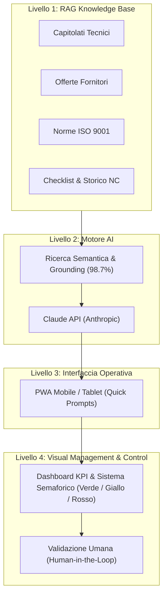

# BPR-Processo-qualit-fondazione-unisa

**Analisi e Miglioramento del Processo di Gestione della Qualità della Fondazione UniSA mediante Metodologia Lean e Intelligenza Artificiale**

---

## 📌 Indice dei Contenuti
- [Descrizione del Progetto](#-descrizione-del-progetto)
- [Contesto e Problematiche AS-IS](#-contesto-e-problematiche-as-is)
- [Metodologia e Approccio Lean](#-metodologia-e-approccio-lean)
- [La Soluzione: SAQO](#-la-soluzione-saqo)
- [Architettura del Sistema](#-architettura-del-sistema)
- [Risultati Misurabili (AS-IS vs TO-BE)](#-risultati-misurabili-as-is-vs-to-be)
- [Roadmap Kaizen e Sviluppi Futuri](#-roadmap-kaizen-e-sviluppi-futuri)
- [Struttura del Repository](#-struttura-del-repository)
- [Crediti Accademici](#-crediti-accademici)

---

## 📖 Descrizione del Progetto

Il progetto **SAQO** (*Sistema di Assistenza Qualità Operativa*) nasce con l'obiettivo di analizzare, snellire e digitalizzare il processo di supervisione e controllo della qualità dei servizi esternalizzati (pulizie, cura del verde e ristorazione) gestiti dalla **Fondazione UniSA** (Università degli Studi di Salerno), in piena conformità agli standard internazionali **ISO 9001**.

Integrando i principi del **Lean Management** con un'architettura di **Intelligenza Artificiale Generativa basata su RAG** (*Retrieval-Augmented Generation*), SAQO supera le inefficienze della gestione cartacea e manuale, garantendo tracciabilità, rapidità ispettiva e supporto decisionale continuo secondo il paradigma etico e strategico **Human-in-the-Loop**.

---

## 🔍 Contesto e Problematiche AS-IS

L'analisi dello stato attuale (**AS-IS**) ha evidenziato diverse criticità che rallentavano l'efficacia della Funzione Qualità:
* **Prelievo informativo manuale:** I dati di conformità erano dispersi su modulistica cartacea (es. fogli firma nei locali), costringendo il Responsabile Qualità a verifiche fisiche con elevato spreco di tempo (*Muda* di attesa e movimento).
* **Collo di bottiglia e dipendenza da singolo operatore:** L'assenza di una banca dati centralizzata rendeva l'intero flusso dipendente dalla presenza fisica del Responsabile Qualità.
* **Redazione non standardizzata:** Mancanza di template digitali condivisi per capitolati tecnici e gestione delle Non Conformità (NC), con tempi lunghi di elaborazione e rischio di errori formali.

---

## ⚙️ Metodologia e Approccio Lean

Per identificare le cause radice e strutturare il piano di intervento sono stati applicati i seguenti strumenti di Quality Management:
1. **Stakeholder Analysis:** Mappatura tramite Matrice Potere/Interesse (quadranti: *Monitora*, *Tienimi Soddisfatto*, *Tienimi Informato*, *Gestisci Attivamente*).
2. **Voice of the Customer (VOC):** Ascolto delle esigenze della comunità accademica e identificazione dei *Muda* (sprechi).
3. **Diagramma di Ishikawa (Causa-Effetto) e Tecnica dei 5 Why:** Analisi condotta sulle dimensioni *Metodo*, *Macchinari*, *Persone*, *Materiali* e *Misurazioni*.
4. **Obiettivi S.M.A.R.T.:**
   * Eliminazione del 100% del prelievo cartaceo manuale.
   * Riduzione del 40% del tempo speso in solleciti e burocrazia manuale.
5. **Matrice Decisionale Ponderata:** Selezione della contromisura ottimale fra Chatbot AI, Registri documentali, Dashboard KPI e Workflow digitali.
6. **Visual Management:** Implementazione di un sistema semaforico (**Verde / Giallo / Rosso**) su 5 aree critiche (documentazione, scadenze, checklist, NC, azioni correttive).

---

## 💡 La Soluzione: SAQO

**SAQO** è un assistente documentale intelligente progettato per affiancare il Responsabile Qualità e i Tecnici Ispettori durante i sopralluoghi e la gestione amministrativa.

### Caratteristiche Chiave:
* **Paradigma Human-in-the-Loop:** L'AI propone bozze, evidenze e riferimenti normativi; la decisione finale e la firma rimangono sempre in capo al valutatore umano.
* **Quick Prompts Pre-configurati:**
  1. *Verifica di conformità sul campo* (recupero clausole e frequenze in ~1,5 minuti).
  2. *Apertura assistita delle contestazioni* (bozze di Non Conformità referenziate in ~4 minuti).
  3. *Analisi delle cause radice* (guida strutturata nei 5 Why basata sullo storico delle anomalie).
  4. *Consultazione rapida delle normative* (riferimenti immediati a standard ISO 9001 e capitolati).
* **Fattore Allucinazioni Azzerato:** Grounding semantico sui documenti della Fondazione pari al **98,7%** (tasso di allucinazione ridotto all'1,3%).

---

## 🏛️ Architettura del Sistema



1. **Livello 1 — Base Documentale (RAG Knowledge Base):** Indicizzazione semantica di capitolati, procedure ISO, checklist e storici NC.
2. **Livello 2 — Motore AI:** Elaborazione semantica avanzata tramite Claude API di Anthropic con grounding documentale stretto.
3. **Livello 3 — Interfaccia Operativa (PWA):** Web App fruibile da dispositivi mobili durante i controlli sul campo, con pulsanti dedicati ai prompt più frequenti.
4. **Livello 4 — Dashboard KPI & Monitoraggio:** Pannello di visual management a semafori per il controllo in tempo reale di scadenze e anomalie.

---

## 📊 Risultati Misurabili (AS-IS vs TO-BE)

L'introduzione della soluzione ha garantito un efficientamento medio superiore al **90%** sui principali indicatori di processo:

| Indicatore di Performance (KPI) | Configurazione AS-IS | Configurazione TO-BE | Variazione |
| :--- | :---: | :---: | :---: |
| **Lead-Time ciclo Non Conformità** | 52 h | 3,5 h | **-93%** |
| **Tempo di Redazione scheda NC** | 45 min | 4 min | **-91%** |
| **Tempo di Ricerca Documentale** | 32 min | 1,5 min | **-95%** |
| **Percentuale NC con Errori Formali** | 35% | 3% | **-91%** |
| **Ore di Reportistica Mensile** | 3,5 h | 22 min | **-90%** |

---

## 🚀 Roadmap Kaizen e Sviluppi Futuri

Il piano di miglioramento continuo (*Kaizen*) prevede una roadmap a sprint bimestrali:
* **Sprint 5:** Modalità offline della PWA per ambienti senza copertura di rete e wizard guidato per prompt personalizzati.
* **Sprint 6:** Auto-sincronizzazione della base RAG da cartelle cloud e integrazione della firma digitale qualificata eIDAS.
* **Sprint 7-8:** Modulo di analisi predittiva delle anomalie ricorrenti e portale read-only per i fornitori accreditati.
* **Sprint 9-10:** Applicazioni native iOS e Android per sopralluoghi sul campo.

---

## 📁 Struttura del Repository

```text
├── Relazione Processo Qualità Gruppo 3.pdf   # Relazione tecnica completa (15 pagine)
├── Processo_Qualità.pptx                     # Presentazione ufficiale del progetto
└── README.md                                 # Documentazione generale di progetto
```

---

## 🎓 Crediti Accademici

* **Istituzione:** [Università degli Studi di Salerno](https://www.unisa.it)  
* **Dipartimento:** Dipartimento di Scienze Aziendali — Management & Innovation Systems (DISA-MIS)  
* **Corso:** Quality Management, Leadership & Decision Making  
* **Docenti:** Prof.ssa Paola Adinolfi, Prof.ssa Ornella Malandrino  
* **Anno Accademico:** 2026/2027  

### 👥 Gruppo di Lavoro (Gruppo Processo Qualità):
* **Angelo Andrea Albano**
* **Giuseppe Altamura**
* **Fabio D'Amato**
* **Emanuele Violi**
* **Salvatore De Gregorio**

---
*Progetto realizzato a scopo didattico e accademico.*
